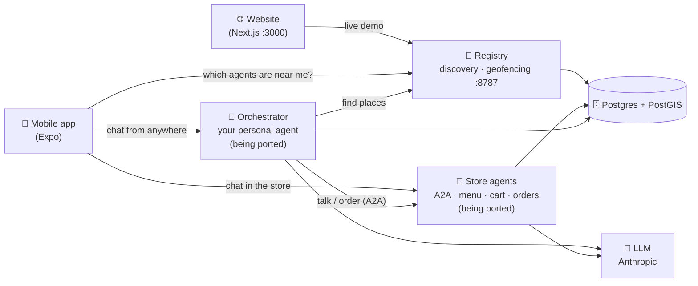
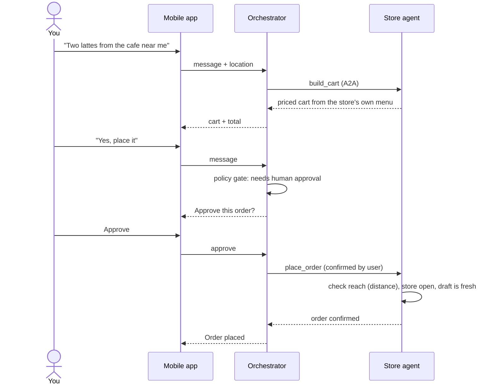
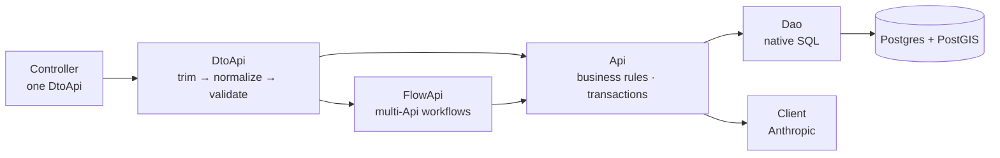

# WalleLabs

**Every place gets its own AI agent.** Talk to a store's agent when you're standing in it, or let your personal agent
find the nearest one and order for you, agent to agent. Working name: **Nyby**.

Shops, cafes, buildings, parks and museums each have an agent configured by its owner. The agents speak open
protocols (A2A for agent-to-agent messaging), so any compatible agent can talk to them, not just ours.

> Status: early build. Discovery, geofencing and the first mobile app and website run end to end on a local stack.
> The backend is now one Node + TypeScript service; store agents and the personal agent are being ported to it.

## How it fits together



### Ordering flow (design)

A personal agent can never spend your money on its own: placing an order always pauses for your approval in the app.
This is the design the store agents and orchestrator are being ported to.



### Inside WalleBackendTs

WMS Core layering: each layer calls only the one below it, business rules live only in the Api layer, and an
architecture test fails the build if anyone skips a layer.



## Repositories

| Repo | What it is | Stack |
|------|------------|-------|
| [**WalleBackendTs**](https://github.com/WalleLabs/WalleBackendTs) | The server. Registry (discovery, geofencing, "which store am I in?", agent cards, menus), schema migrations and seeding; store agents and the personal agent are being ported. WMS Core layering: Controller → DtoApi → Flow → Api → Dao. | Node, TypeScript, Fastify, pg, zod |
| [**WalleDockerCompose**](https://github.com/WalleLabs/WalleDockerCompose) | One-command local stack: PostGIS + the backend + the website, plus a seed job with sample Austin stores. | Docker Compose |
| [**mobile-mono-repo**](https://github.com/WalleLabs/mobile-mono-repo) | The Expo mobile app (Explore map, store chat, orders) plus the original TypeScript prototype of the backend that WalleBackendTs replaces. | Expo, React Native, TypeScript |
| [**Docs**](https://github.com/WalleLabs/Docs) | Product, strategy, competitive research, architecture, business plan and pitch deck. Start with the numbered docs in `docs/`. | Markdown |
| [**Website**](https://github.com/WalleLabs/Website) | The public site, styled like the iOS app: landing page, a live demo that runs on the real registry, and a page for stores. | Next.js 16, TypeScript |

## Run it locally

```bash
# clone the three repos side by side
git clone https://github.com/WalleLabs/WalleBackendTs.git
git clone https://github.com/WalleLabs/Website.git
git clone https://github.com/WalleLabs/WalleDockerCompose.git
cd WalleDockerCompose
cp .env.example .env
docker compose up -d --build                # the api migrates the database on start
docker compose run --rm --build seed        # loads 10 sample stores in Austin
```

Website on `:3000`, registry on `:8787`. Open http://localhost:3000/explore for the live demo, or point the mobile
app at the registry and set the simulator location to Austin (`30.2687,-97.7428`).

## Principles

- **Money rules live in code, not in prompts.** Prices come only from a store's menu; ordering is gated by distance
  rules the owner sets; a personal agent can never place an order without the human approving it in the app.
- **Calm by default.** One front door per place, intent-first app, private personal agents.
- **Open protocols.** Store agents publish A2A agent cards with a location extension, so they're discoverable by anyone.
- **Location is used, not kept.** "Which store am I in?" is answered per request and never stored.

## Status & roadmap

| Area | State |
|------|-------|
| Discovery, geofencing, presence | Working |
| Store agents, menu, priced cart, orders | Being ported to the TypeScript backend |
| Personal agent + human approval | Being ported to the TypeScript backend |
| Mobile app (Explore, chat, orders shell) | Working prototype (chat returns once store agents are ported) |
| Website (landing, live demo, for stores) | Working, not deployed yet |
| Payments, POS sync, production auth, MCP connections | Planned |
