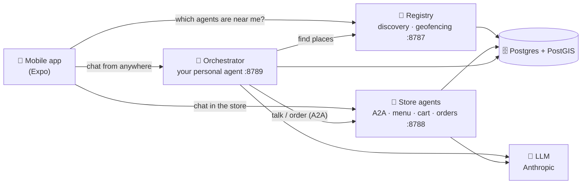
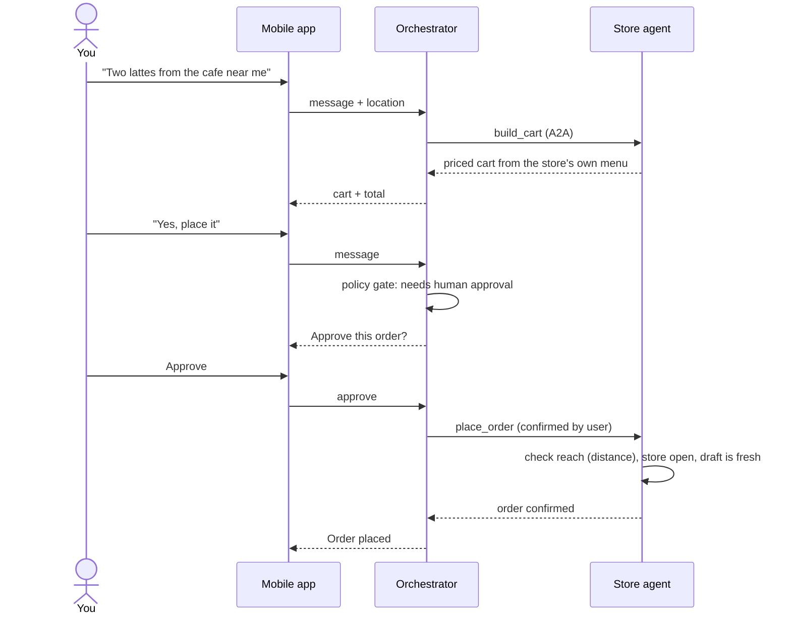
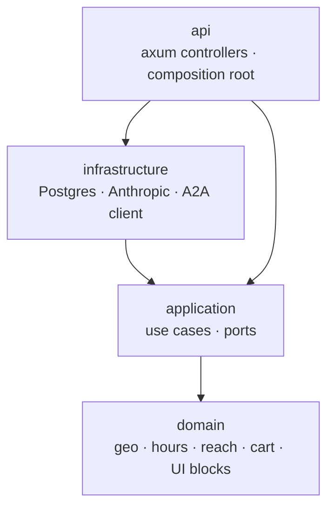

# WalleLabs

**Every place gets its own AI agent.** Talk to a store's agent when you're standing in it, or let your personal agent
find the nearest one and order for you, agent to agent. Working name: **Nyby**.

Shops, cafes, buildings, parks and museums each have an agent configured by its owner. The agents speak open
protocols (A2A for agent-to-agent messaging), so any compatible agent can talk to them, not just ours.

> Status: early build. Discovery, store agents, ordering with human approval and the first mobile app work end to end
> on a local stack. Payments, POS sync and production auth are next.

## How it fits together



### Ordering flow

A personal agent can never spend your money on its own: placing an order always pauses for your approval in the app.



### Inside WalleBackend

Dependencies point inward, so controllers never touch SQL and business rules never touch HTTP.



## Repositories

| Repo | What it is | Stack |
|------|------------|-------|
| [**WalleBackend**](https://github.com/WalleLabs/WalleBackend) | The server. Registry (discovery, geofencing, "which store am I in?"), store agents (A2A, cart pricing, orders) and the personal-agent orchestrator (threads, tools, approvals). Clean architecture: `domain` → `application` → `infrastructure` → `api`. | Rust, axum, sqlx |
| [**WalleDockerCompose**](https://github.com/WalleLabs/WalleDockerCompose) | One-command local stack: PostGIS + the backend + a seed job with sample Austin stores. | Docker Compose |
| [**mobile-mono-repo**](https://github.com/WalleLabs/mobile-mono-repo) | The Expo mobile app (Explore map, store chat, orders) plus the original TypeScript prototype of the backend that WalleBackend replaces. | Expo, React Native, TypeScript |
| [**Docs**](https://github.com/WalleLabs/Docs) | Product, strategy, competitive research, architecture, business plan and pitch deck. Start with the numbered docs in `docs/`. | Markdown |
| [**Website**](https://github.com/WalleLabs/Website) | The public website. Not started yet. | — |

## Run it locally

```bash
git clone https://github.com/WalleLabs/WalleBackend.git
git clone https://github.com/WalleLabs/WalleDockerCompose.git
cd WalleDockerCompose
cp .env.example .env            # add ANTHROPIC_API_KEY for agent chat
docker compose up -d --build
docker compose run --rm seed    # loads 10 sample stores in Austin
```

Registry on `:8787`, store agents on `:8788`, orchestrator on `:8789`. Point the mobile app at them and set the
simulator location to Austin (`30.2687,-97.7428`).

## Principles

- **Money rules live in code, not in prompts.** Prices come only from a store's menu; ordering is gated by distance
  rules the owner sets; a personal agent can never place an order without the human approving it in the app.
- **Calm by default.** One front door per place, intent-first app, private personal agents.
- **Open protocols.** Store agents publish A2A agent cards with a location extension, so they're discoverable by anyone.
- **Location is used, not kept.** "Which store am I in?" is answered per request and never stored.

## Status & roadmap

| Area | State |
|------|-------|
| Discovery, geofencing, presence | Working |
| Store agents, menu, priced cart, orders | Working |
| Personal agent + human approval | Working (needs an Anthropic API key) |
| Mobile app (Explore, chat, orders shell) | Working prototype |
| Payments, POS sync, production auth, MCP connections | Planned |
